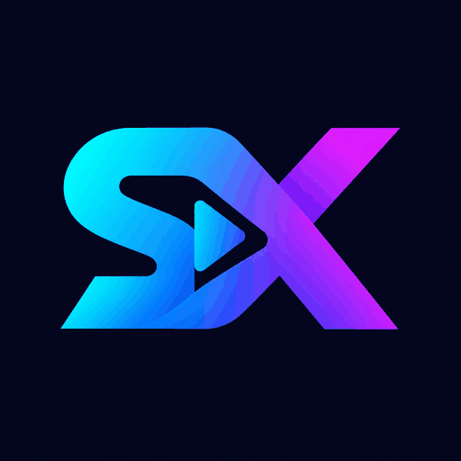

<p align="center">
  
</p>
<h1 align="center">StayX</h1>
<p align="center"><strong>Your videos. Your way.</strong><br>Android customization tools, optional playback controls, and a reproducible local build workflow.</p>
<p align="center">
  <a href="https://github.com/karthik-cracking/StayX/releases"></a>
  <a href="LICENSE"></a>
  
  
</p>

**StayX is an independent customization project.** This repository publishes the build scripts, branding assets, configuration, and custom modifications used to create StayX. It is not the original YouTube source code and is not affiliated with Google, YouTube, Morphe, ReVanced, or YTDLnis.

## What you can control

| Feature | Control |
|---|---|
| Ad hiding | Supported video, feed and fullscreen ad controls |
| Local downloads | Player download button hands off to YTDLnis |
| Background playback | Optional restriction-removal control |
| SponsorBlock | Optional community-reported segment skipping |
| Quality & speed | Remember selections and choose defaults |
| Swipe controls | Configure brightness, volume, or speed gestures |
| Picture-in-picture | Optional floating-player button |
| Feed & Shorts | Individually hide unwanted interface components |
| Playback queue | Choose queue behavior from Feed settings |
| StayX colors | Editable dark background and cyan/violet seekbar colors |

The app keeps the **original YouTube launcher icon** with the name **StayX**. StayX branding appears inside the app. Its settings icon uses a transparent SX silhouette, avoiding Android's white-square tinting problem.

New feature switches default to off; ad/download functionality is retained. Some changes require restarting the app. Theme colors use selectors rather than a single master switch.

## Install and use

Download the APK from [Releases](https://github.com/karthik-cracking/StayX/releases) or build locally. Review the release's compatibility notes before installing. An independently signed build cannot replace Google's installed app; StayX uses its own package, `com.tubemod.android.youtube`, and can coexist with it.

Open **You → Settings → StayX → Settings**. Follow the [feature guide](docs/FEATURES.md) for each setting.

Downloads use the separately installed [YTDLnis](https://github.com/deniscerri/ytdlnis) companion. Tap a video's download arrow, select quality, and confirm. Files save to `Download/YTDLnis/Video`. This is a companion workflow, not a self-contained one-tap downloader.

A compatible MicroG installation is needed for this non-root customization. The development device already had MicroG installed; the project does not bundle or silently replace it.

## Compatibility and limits

- Pinned input: **YouTube 21.42.243**, Android API 29+.
- Patches: **Morphe 1.48.0-dev.15**; patcher: **Morphe Desktop 1.18.1**; resources: **Apktool 3.0.3**.
- The upstream patches list experimental support for **21.42.241**, so the exact 21.42.243 input uses a compatibility override. The build script checks the input's SHA-256 before allowing it.
- Tested on **one Realme RMX3853 phone**. This is not a claim of support for every Android device, video, account, or ad format.
- Tests covered installation, launch, playback, a complete 360p MP4 download, feature-switch changes, theme application after restart, and launcher/settings artwork. Every combination of queue, gestures, PiP, background playback and SponsorBlock categories has not been exhaustively tested.
- Android TV / Fire TV work is a separate investigation and is currently on hold.

## Build locally

You supply the supported original APK and your own signing key. The repository contains neither an original YouTube APK nor a private signing key. The open-source license covers this project's tooling and applicable modifications; it does not relicense Google's proprietary application code or grant trademark rights.

Prerequisites: Python 3.12+, a full JDK 17+ (tested with JDK 25.0.3), Android SDK build-tools (tested with 36.0.0), and enough RAM/disk space for a large APK rebuild. Windows is the tested build host; other hosts have not been validated. Header rendering uses a local bold font; set `STAYX_FONT` to a TTF file for consistent typography.

```powershell
python -m venv .venv
.venv\Scripts\Activate.ps1
python -m pip install -r requirements.txt

# Create a private signing key if you do not already have one.
# keytool prompts for passwords; never commit the key or credentials.
keytool -genkeypair -keystore stayx.p12 -storetype PKCS12 -alias stayx -keyalg RSA -keysize 3072 -validity 3650

# Set these securely in this shell before building:
# STAYX_KEYSTORE_PASSWORD and STAYX_KEY_PASSWORD

python scripts/build.py --input "D:\inputs\youtube-21-42-243.apk" `
  --keystore "D:\private\stayx.p12" --alias stayx `
  --build-tools "$env:LOCALAPPDATA\Android\Sdk\build-tools\36.0.0"
```

Pinned dependencies are downloaded from their official GitHub releases and SHA-256 checked. Build outputs go to `dist/`; intermediate files go to a fresh `build/local/` directory. To rebuild again, pass a new `--work` directory. The script never deletes an existing build directory automatically.

**Keep your signing key backed up privately.** Future updates must use the same key. The repository and public source ZIP intentionally exclude signing keys, passwords, APK inputs, personal device data, and generated build directories.

## Project layout

```text
assets/                 StayX logo
config/                 Patch selections, default controls, tool checksums
scripts/build.py        Portable build orchestration
scripts/java/           About renderer and optional-default modifications
scripts/theme_configs.py  Preserve synthetic theme resource configurations
docs/                   Feature guide and verification notes
LICENSE + NOTICE        Tooling license and preserved upstream notices
```

## How the build works

1. Validate the exact input APK and pinned tools.
2. Apply the selected upstream feature patches.
3. Add StayX branding while restoring YouTube's launcher icon.
4. Replace the About renderer, preserve upstream notices, and keep new controls optional.
5. Rebuild resources; preserve the theme patch's synthetic resource configurations through the standard resource compiler.
6. Align, sign with your private key, and verify the result.

See [BUILD-NOTES](docs/BUILD-NOTES.md) for reproducibility details and [CHANGELOG](CHANGELOG.md) for the initial release.

## Contributing

Keep changes focused and include the exact base version, patch version, Android version, and reproduction steps when reporting a bug. Remove account information, tokens, signing credentials, and personal logs before posting. Do not commit APKs or signing material to the source tree. A version upgrade needs its own compatibility and device testing; do not simply remove the input checksum check.

## Credits and license

- [Morphe patches](https://github.com/MorpheApp/morphe-patches/tree/v1.48.0-dev.15) and [Morphe Desktop](https://github.com/MorpheApp/morphe-desktop): feature patching and dexlib2 tooling.
- [Apktool](https://github.com/iBotPeaches/Apktool): resource decoding and rebuilding.
- [REA](https://github.com/morluto/rea): static artifact inspection and evidence during development.
- [YTDLnis](https://github.com/deniscerri/ytdlnis): external download handling.

Custom build tooling and modifications are provided under [GPL-3.0](LICENSE), with the upstream [NOTICE](NOTICE) preserved. Modified versions are identified as **StayX**, not an official upstream release. Third-party software, underlying application code, and trademarks retain their own rights and terms. The project is provided without warranty.
